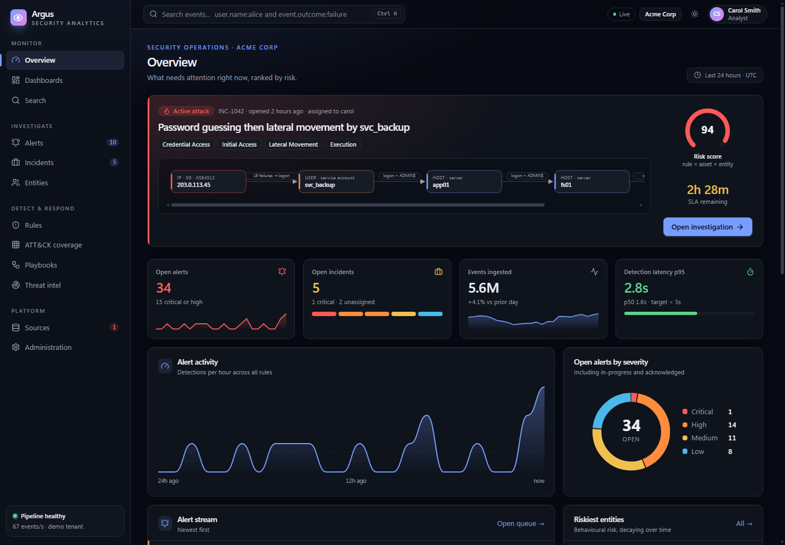
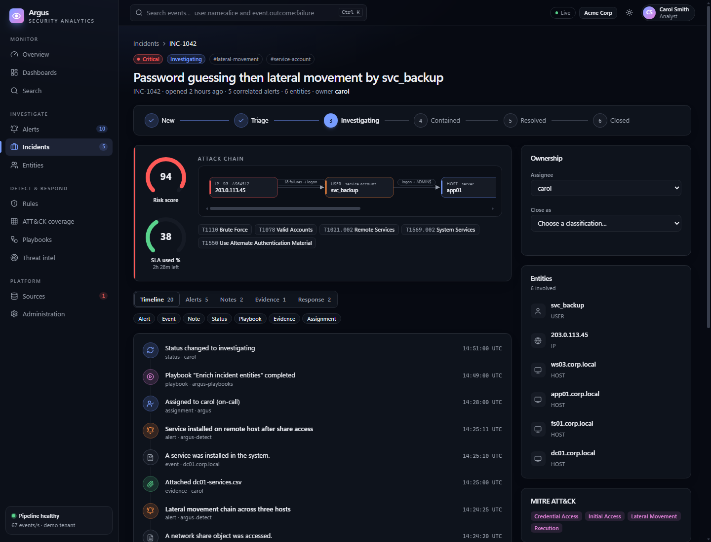
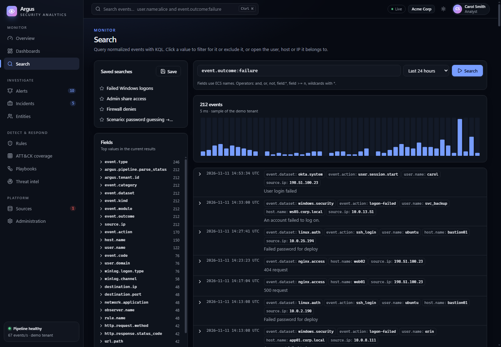
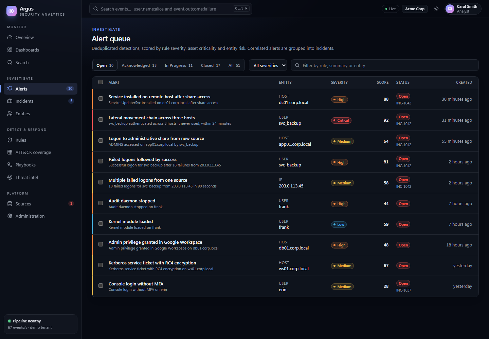
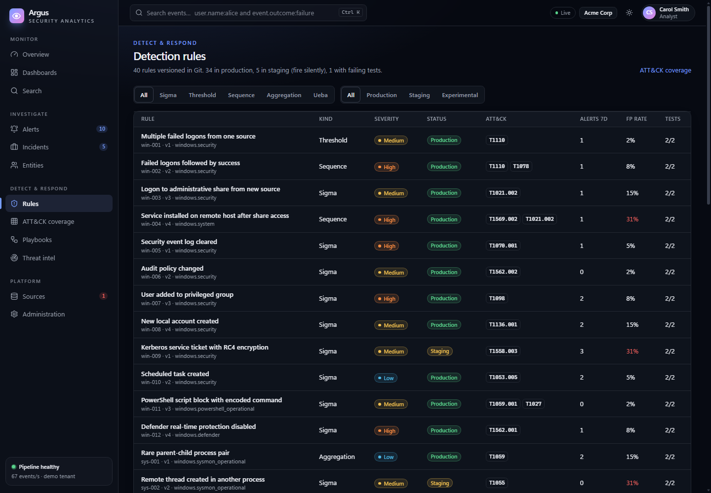
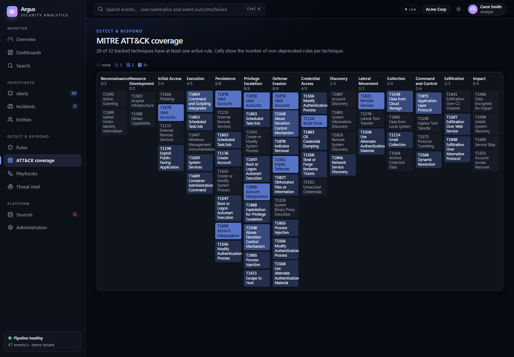
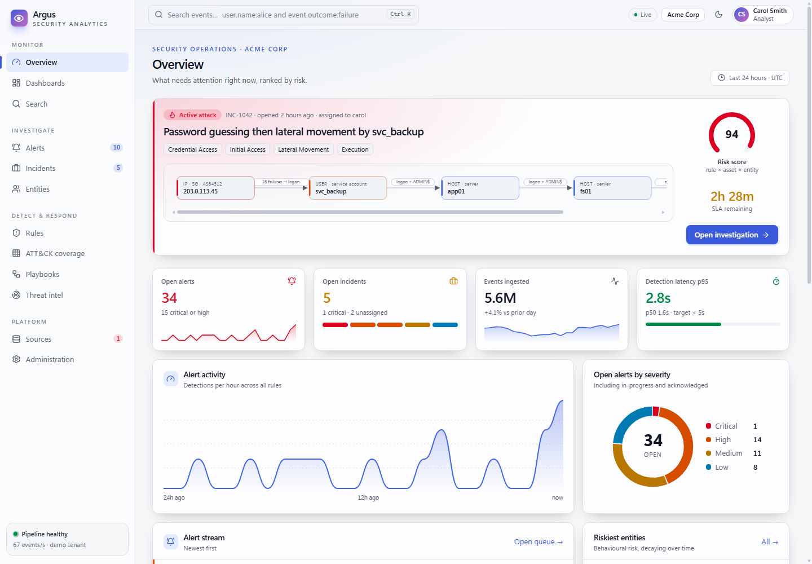
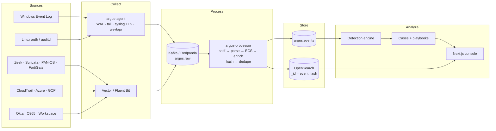

<div align="center">

# Argus

**An open, multi-tenant SIEM: from raw log line to correlated incident.**

Go stream processing · Elastic Common Schema · Kafka-protocol bus · OpenSearch · Next.js 15 analyst console

[Quickstart](#quickstart) · [Architecture](#architecture) · [Engineering notes](#engineering-notes) · [Status](#status-and-roadmap) · [Docs](docs/)



</div>

---

## Why Argus

Most SIEM demos stop at "logs go into Elasticsearch". Argus covers the hard parts in between:

- **Loss and duplicates under failure.** At-least-once transport plus idempotent sinks, so each event shows up exactly once. A chaos test kills the processor mid-write and checks every event.
- **Seventeen real log formats** normalized into one schema, from Windows Security XML to CloudTrail, Okta, Zeek and PAN-OS. Every parser except Windows has unit tests and a fuzz target.
- **An analyst console built for triage, not decoration.** It ranks by risk, lays out the attack chain and runs approval-gated playbooks, with a query language parsed in the browser.

The repository also contains a seeded demo tenant with a scripted intrusion. You can open the console and investigate a real-looking incident without any infrastructure.

## The console

<table>
<tr>
<td width="50%"><br><sub><b>Incident workspace.</b> A status stepper, risk and SLA gauges, the attack chain across entities, ATT&amp;CK techniques, and a filterable timeline of alerts, events, notes, playbook runs and evidence.</sub></td>
<td width="50%"><br><sub><b>Search.</b> KQL over ECS fields, an event histogram and top values per field. Click any value to filter for it, exclude it, or pivot to its user, host or IP.</sub></td>
</tr>
<tr>
<td><br><sub><b>Alert queue.</b> Status counts, a severity strip per row, bulk triage, and a slide-over detail panel. Alerts close as true positive, benign or false positive.</sub></td>
<td><br><sub><b>Detection rules.</b> Sigma, threshold, sequence, aggregation and UEBA rules versioned in Git. Each shows its status, ATT&amp;CK mapping, false-positive rate and test results.</sub></td>
</tr>
<tr>
<td><br><sub><b>ATT&amp;CK coverage.</b> Rules per technique across all 14 tactics; click a cell to see its rules.</sub></td>
<td><br><sub><b>Light theme.</b> Every view ships in both themes with a strict CSP and keyboard navigation (<kbd>Ctrl</kbd>+<kbd>K</kbd> to search).</sub></td>
</tr>
</table>

## Quickstart

No Docker and no cloud account are needed for either of these.

### Run the analyst console (Node 20+)

```bash
npm --prefix web ci
```

```bash
npm --prefix web run dev
```

Open <http://localhost:3000>. The demo tenant replays this intrusion:

1. An external address (`203.0.113.45`) guesses the password of the `svc_backup` service account 18 times.
2. The 19th attempt succeeds.
3. The account then moves from `app01` to `fs01` to `dc01` over `ADMIN$` shares and installs a service on the domain controller.
4. Five detections fire. The correlator groups them into incident **INC-1042** with a risk score of 94.
5. The *Enrich incident entities* playbook has already run on the incident.

**A five-minute tour:**

1. Click **Open investigation** on the overview banner.
2. Walk the timeline and add a note.
3. Dry-run the *Disable account and revoke sessions* playbook. Destructive steps stop and wait for a second approver.
4. Go to **Search** and run `argus.scenario:bruteforce-lateral`.
5. Open **Rules → win-001** and paste an event into the test runner.

To use a real back end instead, set `ARGUS_API_URL` (see [`web/.env.example`](web/.env.example)). The route handlers then proxy every request to it.

### Build and test the back end (Go 1.25+)

```bash
go test ./...
```

```bash
go build -o bin/ ./cmd/...
```

The test run includes the chaos suite. Kafka is simulated with franz-go's in-process broker, so the run needs no external services.

## Architecture



| Layer | Choice | Why ([ADRs](docs/adr/)) |
|---|---|---|
| Schema | Elastic Common Schema 8.11, flat dotted keys | One query language across all sources, and Sigma rules map onto it directly ([0001](docs/adr/0001-common-schema-ecs.md)) |
| Bus | Kafka protocol (Redpanda in dev) | Replayable, keyed by tenant, and its consumer offsets are the source of truth for progress ([0003](docs/adr/0003-redpanda-kafka-and-go-processors.md)) |
| Processing | Go with franz-go | Static binaries, cheap goroutine-per-partition, no JVM to tune |
| Hot storage | OpenSearch, bulk `create` | Search plus aggregations; deterministic `_id` makes writes idempotent ([0002](docs/adr/0002-hot-storage-opensearch.md)) |
| Detection | Streaming rules with bounded state | Sigma, threshold, sequence and aggregation rules evaluated on `argus.events` ([0005](docs/adr/0005-detection-engine-design.md)) |
| Console | Next.js 15, React 19, Tailwind 4 | Server components for data-heavy pages, with client islands for search and triage |

The full C4 and data-flow views are in [docs/ARCHITECTURE.md](docs/ARCHITECTURE.md). The SIEM's own attack surface is covered in [docs/THREAT_MODEL.md](docs/THREAT_MODEL.md).

## Engineering notes

### Exactly-once effect over an at-least-once world

Every hop can fail after sending but before recording the acknowledgement, so retries — and therefore duplicates — are unavoidable. Argus makes them harmless instead of trying to prevent them ([ADR-0004](docs/adr/0004-exactly-once-effective-delivery.md)):

```text
event.hash = sha256( tenant ‖ source ‖ canonical(raw) ‖ provider-id-or-offset )
```

- **Index writes are idempotent.** The OpenSearch bulk request uses `create` with `_id = event.hash`, so a replayed event returns `409 version_conflict`. That counts as a duplicate, not an error.
- **The dedupe key is marked last.** The processor checks the dedupe store before writing, but marks the key only after the index write *and* the `argus.events` produce are both acknowledged. A crash between write and mark replays the batch, and the sink absorbs it.
- **Offsets are committed last.** Kafka offsets are committed after the batch is durable. The consumer runs with `BlockRebalanceOnPoll`, so a rebalance can't split a batch.

The chaos suite in [`test/chaos`](test/chaos) injects crashes right after a downstream write and before the commit, at seeded random points. It does this for 100,000 events on an in-memory log and 20,000 over the Kafka protocol. Each run must end with every event indexed exactly once.

### Parsers that never take the pipeline down

- A **registry sniffs the format** of each raw record before parsing, in a fixed order, trying each parser's `Detect` check. Anything unrecognized still gets a parse status and is preserved raw in an unparsed index, where it can be re-parsed after a fix.
- **Every parse call is wrapped in panic recovery.** A malformed record becomes a counted failure, not a crashed consumer.
- **Each parser has table-driven tests, a native Go fuzz target and a seed corpus.** The tests have already caught real bugs: RFC 3164 timestamps without a year, `X-Forwarded-For` chains in Nginx logs, Apache `%D` field order, Zeek's literal dotted keys, and Kerberos principals with realm separators.

| Family | Formats |
|---|---|
| Windows | Security, Sysmon and other channels, as XML or JSON, collected natively over `wevtapi` with bookmarks |
| Linux | auth.log, auditd (hex-decoded `saddr`), journald |
| Network | Zeek, Suricata EVE, Nginx, Apache, PAN-OS, FortiGate |
| Cloud | AWS CloudTrail, Azure sign-in/audit/activity, GCP audit, Kubernetes audit |
| Identity and SaaS | Okta, Office 365, Google Workspace |
| Endpoint | osquery |
| Fallback | JSON, CEF, LEEF, RFC 3164 and 5424 syslog |

### An agent that survives the host

`argus-agent` is a single static binary. What it does:

- **Disk write-ahead log.** Records are CRC-framed and replayed after a crash.
- **File tailing.** Checkpoints survive rotation and truncation. On Windows, files are opened with `FILE_SHARE_DELETE` so log rotators can still rename them.
- **Syslog.** Accepts UDP, TCP (octet-counted and newline framing) and TLS, with a sender allow-list.
- **Windows Event Log.** Subscribes to channels and keeps a bookmark per channel.

Ready-made [Vector](deploy/vector/vector.yaml) and [Fluent Bit](deploy/fluent-bit/fluent-bit.yaml) configs produce the same envelope, so existing fleets can ship to Argus without the agent.

### The console

- **KQL, parsed in the browser.** [`web/src/lib/kql.ts`](web/src/lib/kql.ts) is a hand-written recursive-descent parser and evaluator. It handles `and`/`or`/`not`, grouping, wildcards, `field:*` existence and numeric ranges. It also flags costly patterns, such as leading wildcards and free-text terms that scan every field, before the query runs.
- **Strict typing and a strict CSP.** TypeScript runs with `strict` and `noUncheckedIndexedAccess`, and lint fails on any warning. The content security policy has no `unsafe-eval` in production and sets `frame-ancestors 'none'`.
- **One data layer, two back ends.** Route handlers serve the seeded demo store, or proxy to `ARGUS_API_URL` when it is set. The pages don't know which one they're talking to.
- **A design system, not a component dump.** OKLCH tokens drive both themes. Charts are hand-built SVG components with no chart library: area, histogram, donut, gauge, sparkline and attack-chain graph.

## Status and roadmap

This is an eleven-phase build. The current state, without spin:

| Phase | | State |
|---|---|---|
| 1 | Threat model, architecture, schema | ✅ Done |
| 2 | Ingestion, parsers, agent, chaos test | ✅ Done (PII masking and asset/identity enrichment deferred) |
| 3 | Storage tiers, ILM, search API | 🟡 Idempotent OpenSearch sink done; ILM and API next |
| 4 | Detection engine, Sigma import, rule tests | ⬜ Planned |
| 5 | UEBA and 200+ validated detections | ⬜ Planned |
| 6 | Alerting, case management, playbooks | 🟡 Built in the console on demo data; back-end services planned |
| 7 | Threat intel | 🟡 Built in the console on demo data; feed ingestion planned |
| 8 | Analyst console | ✅ Done on demo data |
| 9 | Multi-tenancy, RBAC, SSO | 🟡 Designed in the threat model; console screens built |
| 10 | Infrastructure, CI/CD, observability | ⬜ Planned |
| 11 | Load test, DR drill | ⬜ Planned |

Known gaps in the finished phases:

- The Windows parser and the GeoIP enricher have no unit tests yet.
- Combined Go coverage is about 73%; the target is 90%.
- The race detector needs cgo and will run in CI.

## By the numbers

| | |
|---|---|
| Go | ~19,500 lines across 30+ packages, 131 test functions, a fuzz target per parser |
| TypeScript | ~5,300 lines; KQL and demo-data unit tests in Vitest |
| Parsers | 17 source formats plus a generic fallback |
| Demo content | 40 detection rules, 4 playbooks, 1 scripted multi-stage intrusion |

## Repository layout

```text
cmd/            argus-agent, argus-processor
internal/
  schema/       ECS event type, field constants, event hash
  parsers/      17 parsers + registry, shared helpers, test harness
  pipeline/     envelope, dedupe (memory/Redis), processor loop, Kafka source/sink, metrics
  store/        OpenSearch bulk sink
  agent/        WAL, tailer, syslog listener, Windows event subscription, shipper
  syslog/       RFC 3164 / 5424 parsing
  enrich/       GeoIP / ASN
web/            Next.js analyst console
deploy/         agent example config, Vector and Fluent Bit pipelines
docs/           architecture, schema mapping, threat model, ADRs, screenshots
test/           chaos suite, fuzz corpora
```

## Development

| Task | Command |
|---|---|
| Go tests with coverage | `go test ./... -cover` |
| Fuzz one parser | `go test ./internal/parsers/zeek -run x -fuzz FuzzParse -fuzztime 60s` |
| Validate an agent config | `bin/argus-agent -config deploy/agent/agent.example.yaml -check` |
| Console unit tests | `npm --prefix web test` |
| Console type-check and lint | `npm --prefix web run typecheck` then `npm --prefix web run lint` |
| Console production build | `npm --prefix web run build` |

## Security

To report a vulnerability, see [SECURITY.md](SECURITY.md). For how Argus defends itself, see the [threat model](docs/THREAT_MODEL.md): tenant isolation, a hash-chained audit log, and parser hardening.

## License

Apache License 2.0. See [LICENSE](LICENSE).

<div align="center"><sub>Built by <a href="https://github.com/lumidren">lumidren</a>.</sub></div>
