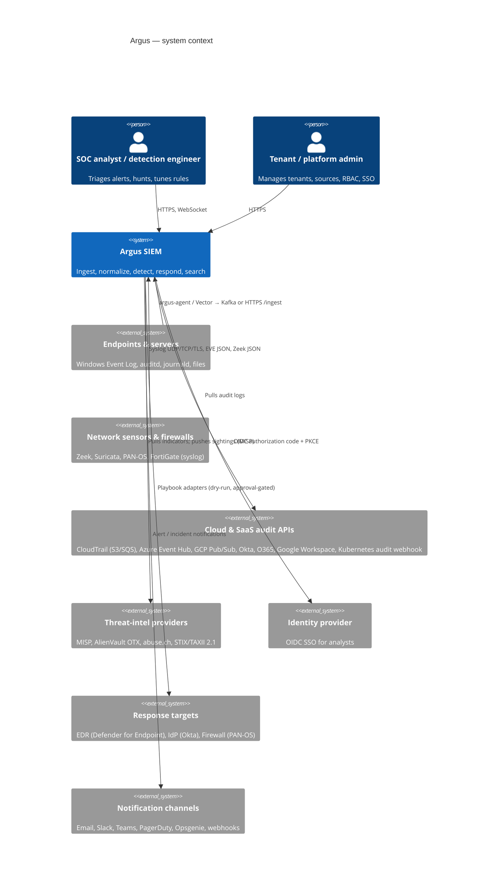
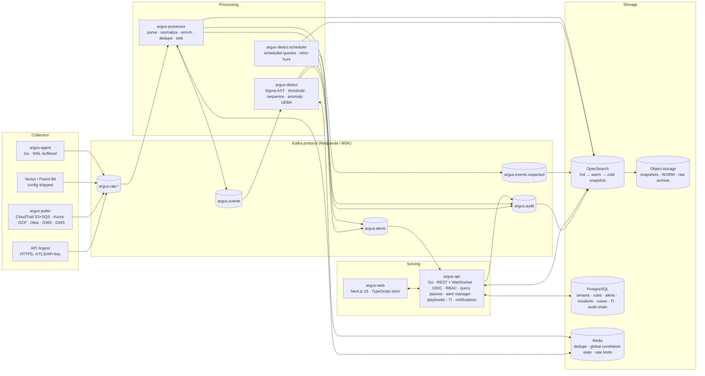
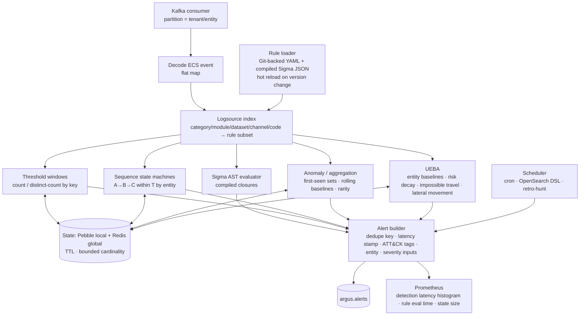
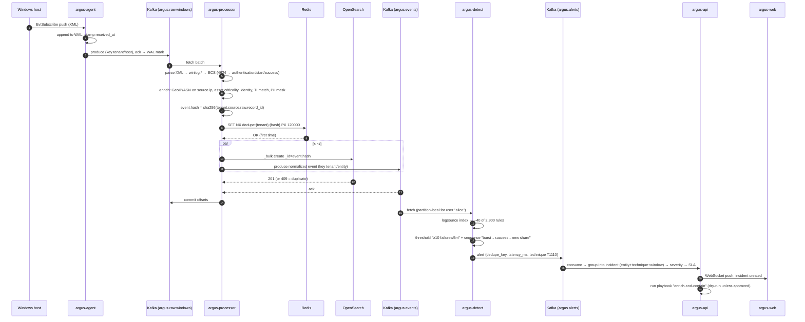
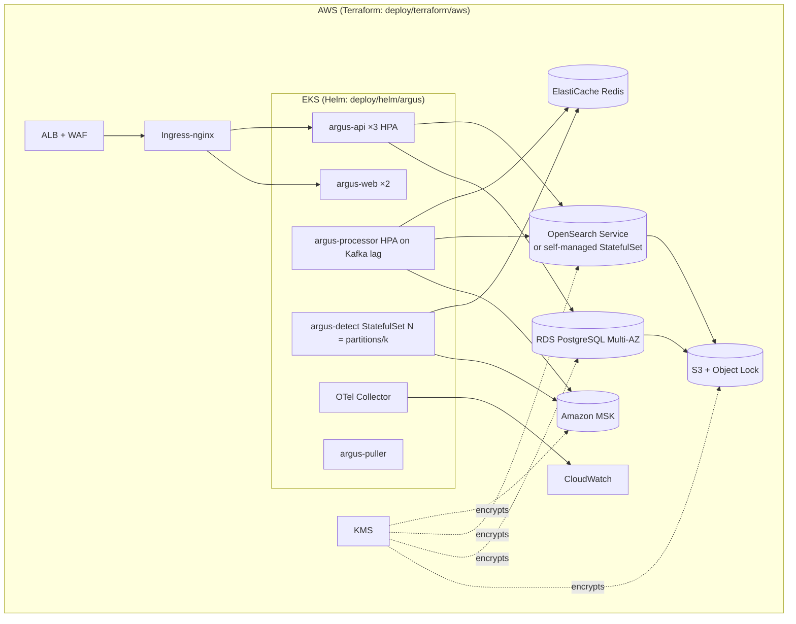

# Argus Architecture

Argus is a multi-tenant SIEM: collectors ship logs to a Kafka-protocol bus, Go stream
processors normalize them to ECS, enrich them, deduplicate them and write them to OpenSearch;
a streaming detection engine evaluates Sigma, threshold, sequence, anomaly and UEBA rules with
partition-local state; alerts are grouped into incidents and handled through a SOC case
workflow with notifications and YAML playbooks; a Next.js analyst application sits on a Go API.

Design decisions with their alternatives are recorded in [`docs/adr/`](adr/). This document
describes the system as built.

---

## 1. C4 Level 1 — System context



## 2. C4 Level 2 — Containers



### Container responsibilities

| Container | Binary / package | Scales on | State |
|---|---|---|---|
| Agent | `cmd/argus-agent` | per host | disk WAL + checkpoints under `--data-dir` |
| Puller | `cmd/argus-puller` | one per tenant/source (leader-elected via Postgres advisory lock) | cursor per source in Postgres |
| Processor | `cmd/argus-processor` | Kafka lag on `argus.raw.*` (HPA) | stateless except Redis dedupe keys |
| Detect | `cmd/argus-detect` | Kafka lag on `argus.events`; partitions ↔ instances | Pebble store per partition + Redis for global rules |
| API | `cmd/argus-api` | CPU / request latency | Postgres |
| Web | `web/` | CPU | none |
| OpenSearch | Helm StatefulSet / AWS OpenSearch Service | storage | ISM-managed indices |
| PostgreSQL | StatefulSet / RDS | storage | WAL-archived, PITR |
| Redis | StatefulSet / ElastiCache | memory | AOF everysec |

## 3. C4 Level 3 — Detection engine components



## 4. Data flow — one event, end to end



## 5. Tenant isolation

- Every event carries `argus.tenant.id`, assigned by the first Argus component to receive it from
  an authenticated channel: the agent's enrolment token, the API key / mTLS client certificate
  of `/ingest`, or the puller's source configuration. Collectors cannot set it themselves; the
  processor overwrites any inbound value.
- OpenSearch indices are per tenant (`argus-{tenant}-*`). The API's query planner forces an
  index pattern derived from the caller's tenant claim and rejects any explicit index in the
  request. The OpenSearch security plugin role per tenant is a second barrier, and document-level
  security on `argus.tenant.id` a third.
- PostgreSQL uses row-level security with `SET LOCAL argus.tenant_id` per transaction; every
  table that holds tenant data has a `tenant_id` column and an RLS policy.
- Redis keys and Kafka message keys are prefixed with the tenant id.
- Isolation is tested end to end in `test/integration/tenant_isolation_test.go`.

## 6. Deployment view



Local development uses `deploy/compose/docker-compose.yml` with Redpanda, OpenSearch,
PostgreSQL, Redis, all Argus services, Grafana/Prometheus/Tempo, and `argus-loadgen` producing
realistic multi-source traffic including the scripted brute-force → lateral-movement scenario.

## 7. Cross-cutting concerns

| Concern | Mechanism |
|---|---|
| Observability | OpenTelemetry traces propagate via Kafka headers (`traceparent`) from agent to alert; Prometheus metrics per service (`internal/telemetry`); Grafana dashboards in `deploy/grafana/dashboards/`; alert rules in `deploy/prometheus/rules/`. |
| Audit | Every privileged API action, rule change, playbook run and evidence operation writes an entry to the hash-chained `audit_log` table; the chain head is also published to `argus.audit` and anchored daily into object storage. |
| Secrets | Read from environment / mounted files only; the structured logger has a redaction hook for known secret field names and high-entropy strings; `test/security/log_secret_scan_test.go` runs every service with secrets set and scans captured logs. |
| PII | `internal/pii` detects email, phone, national-id and card patterns in configured fields and masks them at ingest when the tenant policy requires, storing the HMAC token for pivoting; `pii:unmask` permission reveals the clear value through the API. |
| Supply chain | Go modules with checksums, `npm ci` with lockfile, Semgrep + gosec + Bandit, Trivy, SBOM (Syft), cosign-signed images, CI fails on HIGH/CRITICAL. |

## 8. Repository layout

```
cmd/                  service entrypoints (agent, processor, detect, api, puller, loadgen, replay, rules)
internal/schema       ECS event model, flattening, versioning
internal/parsers      one package per source + registry + fuzz corpus
internal/syslog       RFC 3164/5424 framing and header parsing
internal/enrich       GeoIP, ASN, threat intel, asset/identity, risk, PII
internal/pipeline     Kafka I/O, dedupe, backpressure, OpenSearch sink
internal/store        OpenSearch client, index templates, ISM, snapshots, legal hold
internal/search       KQL parser → OpenSearch DSL, query planner, limits
internal/detect       rule model, Sigma evaluator, stateful engines, scheduler, state stores
internal/ueba         baselines, risk scoring, built-in behavioural detections
internal/alerting     grouping, severity, SLA
internal/cases        case management
internal/notify       channels and escalation policies
internal/playbook     YAML playbooks, runner, adapters (real + mock)
internal/ti           feeds, STIX/TAXII, IOC store, matching, sightings
internal/auth         OIDC, RBAC, tenant resolution
internal/audit        hash-chained audit log
internal/api          HTTP handlers, WebSocket hub
rules/                detection content (Argus YAML, Sigma import tooling output, tests, ATT&CK data)
tools/sigma           pySigma Argus backend, processing pipelines, compile and report scripts
web/                  Next.js analyst application
deploy/               Dockerfiles, compose, Helm, k8s, Terraform, Grafana, Prometheus, Vector, Fluent Bit
test/                 integration, chaos, load, fuzz, dataset validation
docs/                 this document, ADRs, schema, threat model, runbooks, paper
```
