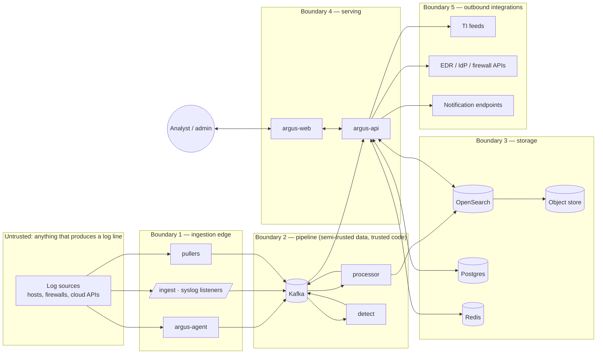

# Argus Threat Model

Scope: the SIEM itself — collectors, bus, processors, storage, detection, API, web application,
playbook adapters, and the people who operate it. The assets we protect are **log integrity**
(an attacker must not be able to erase or forge the record of their activity), **detection
integrity** (an attacker must not be able to blind the engine), **tenant confidentiality**
(one MSSP customer must never read another's data), and **the SIEM's own credentials and
privileges** (it holds EDR, IdP and firewall credentials for response actions).

Method: STRIDE per trust boundary, then abuse cases from the brief. Every threat lists its
mitigations with a code location (`path:line`). Locations are verified in CI by
`tools/threatmodel/check_refs.py`, which fails the build when a referenced file or line range
no longer contains the named symbol, so this document cannot silently rot.

## Trust boundaries

## Threat catalogue

Severity uses the DREAD-lite scale: **Critical** (tenant breach / evidence destruction / RCE),
**High** (detection blinded, privilege gain), **Medium** (data quality, DoS of a component),
**Low** (nuisance). Status is `mitigated`, `partially mitigated` (residual risk described), or
`accepted`.

### T1 — Log injection and forgery

| # | Threat | Severity | Mitigation | Location | Status |
|---|---|---|---|---|---|
| T1.1 | Attacker on a monitored host writes crafted lines into a log file or syslog socket that *look like* events from another host or user (host-name spoofing, fake 4624 success events to bury failures). | High | The collector, not the payload, is the authority for `host.name`/`agent.id`/`argus.tenant.id`: the processor records the collector-asserted identity in `argus.collector.*` and sets `argus.pipeline.host_mismatch=true` when the payload's host differs, so rules can ignore or alert on mismatches. Tenant id is always overwritten from the authenticated channel. | `internal/pipeline/normalize.go` (`assertCollectorIdentity`) | mitigated |
| T1.2 | Forged syslog from an unauthenticated UDP sender (any LAN host can spoof source IP). | High | UDP syslog is disabled by default in shipped Vector/agent configs; TCP+TLS with client certificates is the documented path; when UDP is enabled the listener binds an allow-list of sender CIDRs and tags events `argus.transport=udp` so rules can require TLS provenance for high-severity sources. | `cmd/argus-agent/syslog_input.go` (`allowSender`), `deploy/vector/vector.yaml` | partially mitigated — plain UDP remains spoofable where an operator turns it on; documented in RUNBOOK |
| T1.3 | Control characters, ANSI escapes or newlines inside a field that break the analyst UI, terminal tooling, or downstream exporters (CSV injection). | Medium | The normalizer strips C0 control characters except `\t` from string fields, caps field length (32 KiB, longer values truncated with `argus.pipeline.truncated_fields[]`), and the web app renders all values as text nodes, never HTML; CSV export prefixes `=+-@` cells with `'`. | `internal/schema/sanitize.go`, `web/src/lib/export/csv.ts` | mitigated |
| T1.4 | Attacker replays old legitimate events to trigger threshold rules (alert flooding) or to mask new activity. | Medium | Content-hash dedupe within window (ADR-0004); stateful rules ignore events whose `@timestamp` is older than the allowed lateness; replayed events with a provider-side id collide on `_id`. | `internal/pipeline/dedupe.go`, `internal/detect/engine/watermark.go` | mitigated |
| T1.5 | Attacker crafts an event whose fields match a rule's **filter** (exclusion) selection to make their own activity invisible (e.g. sets `process.parent.executable` to a whitelisted updater path). | High | Rule authoring guideline and lint: exclusions must not rely solely on attacker-controlled strings; `argus-rules lint` flags filters on `command_line`-type fields without a corroborating field; the processor stamps `argus.pipeline.parse_status` so rules can require `ok`. Residual risk is inherent to signature detection and is documented per rule in `falsepositives`. | `cmd/argus-rules/lint.go` (`checkWeakFilter`) | partially mitigated |

### T2 — Parser exploitation

| # | Threat | Severity | Mitigation | Location | Status |
|---|---|---|---|---|---|
| T2.1 | Malformed input crashes a parser (panic) and takes a processor partition down, delaying all tenants on that partition (DoS). | High | Every parser call is wrapped in `recover()`; a panicking parser yields a `failed` parse status and the raw event is preserved; the panic is counted (`argus_parser_panics_total`) and alerted. | `internal/parsers/registry.go` (`safeParse`) | mitigated |
| T2.2 | Pathological input causes super-linear CPU or memory use (regex backtracking, deeply nested JSON, XML entity expansion / billion laughs, zip bombs in CloudTrail S3 objects). | High | Go `regexp` is RE2 (linear); JSON decoding is depth-limited (64) and size-limited (1 MiB per event, configurable); the XML decoder has `Strict=true`, entity expansion disabled (`Entity` map empty) and DTDs rejected; gzip reads are capped at 256 MiB per object with a 100:1 ratio guard; parsers run under a per-event deadline. | `internal/parsers/limits.go`, `internal/parsers/windows/xml.go`, `cmd/argus-puller/cloudtrail/s3.go` (`limitedGunzip`) | mitigated |
| T2.3 | Memory-safety bugs in parsing code. | Critical | Go is memory-safe; no cgo in parsers; `unsafe` is forbidden by a `go vet`/Semgrep rule; every parser has a `go test -fuzz` target with a committed corpus (`test/fuzz/corpus/<parser>/`) run in CI for a bounded time and nightly for longer. | `.semgrep/argus.yml` (`no-unsafe-in-parsers`), `internal/parsers/*/fuzz_test.go` | mitigated |
| T2.4 | Parser misclassifies an event (wrong `event.category`/`outcome`) so a detection silently misses. | Medium | Every mapping row in SCHEMA.md has a table-driven test with a real sample; parser versions are embedded in events so a regression can be scoped and re-parsed from `event.original`. | `internal/parsers/*/parser_test.go`, `cmd/argus-replay` | mitigated |

### T3 — Tenant isolation breach

| # | Threat | Severity | Mitigation | Location | Status |
|---|---|---|---|---|---|
| T3.1 | A tenant user crafts a search that reads another tenant's index (explicit index name, wildcard, alias, `_msearch` body smuggling). | Critical | The API never accepts an index from the client; the planner derives the index pattern from the JWT tenant claim and the dataset parameter from an enum; request bodies are built server-side from the parsed KQL AST, never concatenated; per-tenant OpenSearch roles (security plugin) restrict the API's own credentials per tenant via `opendistro_security` impersonation headers; DLS on `argus.tenant.id` is a third barrier. | `internal/search/planner.go` (`indexPatternFor`), `internal/store/opensearch/tenant_client.go`, `deploy/opensearch/security/roles.yml` | mitigated |
| T3.2 | Postgres data leak across tenants through a missing `WHERE tenant_id` in one of hundreds of queries. | Critical | Row-level security on every tenant table; the connection pool sets `SET LOCAL argus.tenant_id` in every transaction via a wrapper that forbids obtaining a connection without a tenant context (except the migration role); a test enumerates tables and asserts RLS is enabled and forced. | `internal/store/pg/tenant_tx.go`, `internal/store/pg/migrations/0003_rls.sql`, `internal/store/pg/rls_test.go` | mitigated |
| T3.3 | Cross-tenant leakage through shared caches, Redis keys, WebSocket broadcasts, or Kafka consumers. | Critical | Redis keys are namespaced `t:{tenant}:…` by a key-builder that has no un-namespaced constructor; WebSocket hub rooms are keyed by tenant and the publisher asserts the alert tenant equals the room tenant; integration test ingests for two tenants and verifies via every API that tenant B sees nothing of tenant A. | `internal/store/redis/keys.go`, `internal/api/ws/hub.go` (`publish`), `test/integration/tenant_isolation_test.go` | mitigated |
| T3.4 | A collector authenticated for tenant A sends events claiming tenant B. | High | Tenant id is bound to the credential (API key / agent enrolment token / mTLS SAN) at the edge and overwritten; payload-supplied tenant fields are dropped and counted. | `internal/api/ingest/handler.go` (`tenantFromCredential`), `internal/pipeline/normalize.go` | mitigated |
| T3.5 | Noisy neighbour: one tenant floods ingestion or runs heavy queries and starves others. | Medium | Per-tenant ingest rate limits (token bucket at the edge, `429 Retry-After`), per-tenant query time/size/concurrency limits in the planner, and per-tenant OpenSearch index shards so one tenant's hot shards do not dominate. | `internal/api/ingest/ratelimit.go`, `internal/search/limits.go` | mitigated |

### T4 — Insider tampering with evidence

| # | Threat | Severity | Mitigation | Location | Status |
|---|---|---|---|---|---|
| T4.1 | An analyst or compromised SOC account deletes or edits events, alerts, case notes or evidence to cover tracks. | Critical | Event indices are write-once from the API's perspective (the API role has no delete/update on event indices; only ISM may delete at retention); alerts and cases are append-only in Postgres (edits create new rows, `updated_by`, and a hash-chained `audit_log` entry); evidence attachments are stored content-addressed (SHA-256 name) in object storage with Object Lock when WORM is enabled. | `deploy/opensearch/security/roles.yml` (`argus_api_events` has no `delete`), `internal/cases/evidence.go` (`storeContentAddressed`), `internal/audit/chain.go` | mitigated |
| T4.2 | Insider edits the audit log itself. | Critical | `audit_log` rows carry `prev_hash` and `hash = sha256(prev_hash ∥ canonical(row))`; the API process is the only writer (DB role grants INSERT only, no UPDATE/DELETE, enforced by a trigger that raises on UPDATE/DELETE); the chain head is published hourly to `argus.audit` and daily into an Object-Lock bucket; `argus-audit verify` recomputes the chain and compares with anchors. | `internal/audit/chain.go`, `internal/store/pg/migrations/0004_audit_log.sql` (`audit_log_immutable` trigger), `cmd/argus-audit/verify.go` | mitigated |
| T4.3 | Insider with database credentials bypasses the API and edits rows directly. | High | Application roles hold least privilege; the `argus_migrate` role is used only by CI/ops with break-glass logging; Postgres `log_statement=ddl` and `pgaudit` for the audit schema; direct DML would break the hash chain and be detected by the verifier, and WORM anchors cannot be altered. | `deploy/terraform/aws/rds.tf` (`parameter_group` pgaudit), `internal/store/pg/migrations/0001_roles.sql` | partially mitigated — a DBA with superuser can disable triggers; detection, not prevention, is the control |
| T4.4 | Insider legally destroys evidence through retention before an investigation finishes. | High | Legal hold flag per tenant/index/case: ISM delete action is gated on an `argus.legal_hold` index setting; placing a hold is audited and requires the `legal_hold:manage` permission (admin only, two-person rule optional via approval). | `internal/store/ilm/legal_hold.go`, `internal/api/admin/legal_hold.go` | mitigated |

### T5 — Alert suppression by an attacker

| # | Threat | Severity | Mitigation | Location | Status |
|---|---|---|---|---|---|
| T5.1 | Attacker stops the agent or clears the Windows event log before acting. | High | Built-in detections for log clearing (1102/104), audit policy change (4719), Sysmon state change (4), service stop of Sysmon/agent (7036), auditd stop (DAEMON_END); source-health monitor alerts when a registered source goes silent beyond its learned cadence (`argus_source_silent`). | `rules/argus/windows/defense_evasion/*log_cleared*.yml`, `internal/sourcehealth/silence.go` | mitigated |
| T5.2 | Attacker floods the pipeline (event storm) so Kafka lag grows and detection is delayed beyond their dwell time. | High | Per-source and per-tenant rate limits at the edge; detection consumes `argus.events` independently of indexing so indexing back-pressure does not delay detection; HPA on consumer lag; alert on `argus_detect_lag_seconds > 60`. | `internal/api/ingest/ratelimit.go`, `deploy/prometheus/rules/argus.yml` (`ArgusDetectLagHigh`) | mitigated |
| T5.3 | Attacker with analyst access closes their own alerts as false positives or disables a rule. | High | RBAC: `viewer`/`analyst` cannot disable rules or edit rule filters (`engineer`+); closing an alert is audited with the actor and requires a classification + note; a built-in meta-detection alerts when one principal closes > N alerts as FP in M minutes or when an alert about user X is closed by user X (self-closure). | `internal/auth/rbac/policy.go`, `internal/alerting/meta_rules.go` (`selfClosure`, `bulkFPClosure`) | mitigated |
| T5.4 | Attacker exploits a rule exclusion (see T1.5) or mass-produces benign-looking events to push a UEBA baseline so their activity looks normal (baseline poisoning). | Medium | Baselines use robust statistics (median / MAD, not mean / stddev) and cap the contribution per day; first-seen detections are not baseline-dependent; baseline change velocity itself is a detection (`ueba_baseline_shift`). | `internal/ueba/baseline.go` (`robustStats`), `rules/argus/ueba/baseline_shift.yml` | partially mitigated |
| T5.5 | Notification channel sabotage: attacker disables Slack webhook or rotates PagerDuty key. | Medium | Notification config changes are audited and require `admin`; a canary notification fires hourly per channel and a failed canary alerts through every other channel. | `internal/notify/canary.go` | mitigated |

### T6 — Credential exposure in logs

| # | Threat | Severity | Mitigation | Location | Status |
|---|---|---|---|---|---|
| T6.1 | Argus's own structured logs include DSNs, API keys, OIDC client secrets or bearer tokens (e.g. logging a config struct or an HTTP request). | High | The logger wraps `slog` with a redaction handler: known key names (`password`, `secret`, `token`, `authorization`, `api_key`, `dsn`, `cookie`, …) are replaced with `[REDACTED]`, URL userinfo is stripped, and values matching high-entropy/JWT/AWS key patterns are masked; config structs implement `LogValue()` omitting secrets; test boots every service with canary secrets and greps captured logs. | `internal/telemetry/log/redact.go`, `internal/config/config.go` (`LogValue`), `test/security/log_secret_scan_test.go` | mitigated |
| T6.2 | Ingested events contain credentials (passwords in command lines, tokens in URLs, basic-auth in access logs) and are shown to every analyst. | Medium | PII/secret detector at ingest masks configured patterns in `process.command_line`, `url.*`, `http.request.*`, `message` when the tenant policy enables it; masked values are replaced with an HMAC token; `pii:unmask` permission reveals through the API with an audit entry. | `internal/enrich/pii/detector.go`, `internal/api/events/unmask.go` | mitigated |
| T6.3 | Secrets committed to the repository or baked into images. | High | gitleaks pre-commit and CI job; images are built from `scratch`/distroless with no secrets; all secrets arrive via env or mounted files from Kubernetes Secrets / AWS Secrets Manager (Terraform). | `.github/workflows/security.yml` (`gitleaks`), `deploy/helm/argus/templates/secrets.yaml` | mitigated |
| T6.4 | Secrets leak via error messages returned to API clients. | Medium | API errors are mapped to typed problem responses; internal error strings are never returned to clients (logged with a correlation id instead). | `internal/api/httputil/errors.go` (`writeProblem`) | mitigated |

### T7 — SSRF and abuse of outbound integrations

| # | Threat | Severity | Mitigation | Location | Status |
|---|---|---|---|---|---|
| T7.1 | An admin-configurable URL (webhook, TAXII server, MISP, OTX, EDR base URL, OIDC issuer) points at an internal address (cloud metadata `169.254.169.254`, Kubernetes API, Redis) and the API fetches it. | High | One shared `safehttp` client for every outbound call: resolves DNS, rejects loopback/link-local/private/multicast/unspecified ranges unless the destination is on an explicit allow-list, re-validates after redirects (max 3), pins the resolved IP for the connection (no DNS rebinding), enforces timeouts and response size caps, and strips `Authorization` on cross-host redirects. | `internal/safehttp/client.go` (`dialControl`, `checkRedirect`) | mitigated |
| T7.2 | Playbook actions used as an attack tool (disable the CISO's account, isolate domain controllers, block the SOC's own egress). | Critical | Destructive actions (`isolate_host`, `disable_user`, `block_ip`) are approval-gated by default (two distinct principals), dry-run is the default mode for a new playbook, adapters refuse targets on a protected list (domain controllers, break-glass accounts, SIEM egress CIDRs), and every action writes an audit entry with request and response. | `internal/playbook/runner.go` (`requireApproval`), `internal/playbook/adapters/protected.go` | mitigated |
| T7.3 | Notification content injection: alert fields with attacker-controlled text rendered as Slack/Teams markdown or email HTML (phishing the analyst). | Medium | All channel renderers escape field values and never embed URLs from event fields as clickable links (they are code-formatted); only Argus-origin deep links are hyperlinks. | `internal/notify/render.go` (`escapeMarkdown`) | mitigated |
| T7.4 | TI feed poisoning: a compromised or malicious feed publishes indicators for legitimate infrastructure (e.g. Microsoft update servers) to cause mass false positives or playbook-driven blocking. | High | Indicators carry provider confidence; the TI matcher never triggers destructive playbooks on single-feed indicators below a confidence threshold; an allow-list of never-block ranges/domains; feed changes above a size threshold alert the operator before activation. | `internal/ti/ingest.go` (`guardrails`), `internal/ti/allowlist.go` | mitigated |

### T8 — Supply chain

| # | Threat | Severity | Mitigation | Location | Status |
|---|---|---|---|---|---|
| T8.1 | Malicious or vulnerable dependency (Go module, npm package, Python package, base image). | High | Lockfiles with checksums (`go.sum`, `package-lock.json`, `requirements.txt` hashes); Dependabot; `govulncheck`, `npm audit`, `pip-audit`, Trivy image + fs scans; CI fails on HIGH/CRITICAL; SBOM (CycloneDX via Syft) published per image. | `.github/workflows/security.yml`, `.github/dependabot.yml` | mitigated |
| T8.2 | Tampered container image deployed. | High | Images built in CI, signed with cosign keyless (Sigstore / GitHub OIDC); Kubernetes admission (Kyverno policy in Helm chart, optional) verifies signatures; Helm values pin digests. | `.github/workflows/release.yml` (`cosign sign`), `deploy/helm/argus/templates/kyverno-verify-images.yaml` | mitigated |
| T8.3 | Compromised SigmaHQ rule content (a rule that never fires, or one that fires constantly). | Medium | Rule import is a reviewed PR with the compile report diff; staging mode for imported rules before production; rule-content hash is recorded on every alert so a rule change is traceable. | `tools/sigma/compile.py` (`write_report`), `internal/detect/rules/loader.go` | mitigated |
| T8.4 | Compromised CI runner exfiltrates secrets or pushes code. | High | Least-privilege GitHub tokens, OIDC to AWS (no long-lived keys), environments with required reviewers for prod deploy, branch protection with required status checks. | `.github/workflows/deploy.yml` (`environment: production`) | mitigated |

### T9 — Authentication, authorization and session (serving layer)

| # | Threat | Severity | Mitigation | Location | Status |
|---|---|---|---|---|---|
| T9.1 | Credential stuffing / weak passwords on the SIEM login. | High | OIDC SSO is the primary login; local accounts exist only for break-glass, require argon2id hashes, MFA (TOTP) and are rate-limited with lockout. | `internal/auth/local/password.go`, `internal/auth/local/ratelimit.go` | mitigated |
| T9.2 | OIDC implementation flaws (missing `state`/`nonce`, accepting unsigned tokens, audience confusion). | Critical | Authorization code flow with PKCE; `state` and `nonce` bound to the session; ID token signature, `iss`, `aud`, `exp`, `nonce` verified with `coreos/go-oidc`; JWKS cached with rotation; group→role mapping only from configured claims. | `internal/auth/oidc/provider.go` (`verifyIDToken`) | mitigated |
| T9.3 | Horizontal privilege escalation (analyst calls an admin endpoint; viewer posts a case note). | High | Every route declares the required permission; a router-level middleware denies by default; a test enumerates routes and asserts each has an explicit permission. | `internal/api/router.go`, `internal/auth/rbac/permissions.go`, `internal/api/router_test.go` (`TestEveryRouteHasPermission`) | mitigated |
| T9.4 | CSRF / clickjacking / XSS in the web app. | High | Session cookie `SameSite=Strict; HttpOnly; Secure`; double-submit CSRF token on state-changing requests; CSP with nonces and no `unsafe-inline`; `X-Frame-Options: DENY`; React renders text nodes; no `dangerouslySetInnerHTML`. | `internal/api/middleware/security_headers.go`, `web/next.config.ts` (`headers`) | mitigated |
| T9.5 | WebSocket hijacking (cross-site WebSocket). | Medium | Origin check against configured origins; ticket-based auth (short-lived token issued over authenticated HTTPS) rather than cookies. | `internal/api/ws/auth.go` | mitigated |

### T10 — Availability of the SIEM

| # | Threat | Severity | Mitigation | Location | Status |
|---|---|---|---|---|---|
| T10.1 | Disk pressure on OpenSearch hot nodes from an ingest spike. | High | ISM rollover by size and age; watermark alerts; per-tenant quotas; raw topic retention lets ingestion pause without loss. | `deploy/opensearch/ism/hot-warm-cold.json`, `deploy/prometheus/rules/argus.yml` (`OpenSearchDiskPressure`) | mitigated |
| T10.2 | Detection engine stall (deadlock, GC pause, Redis outage). | High | Liveness probe tied to consumer progress, not just HTTP; Redis failure degrades global rules to local state with an alert; `argus_detect_last_event_age_seconds` alert. | `cmd/argus-detect/health.go`, `internal/detect/state/fallback.go` | mitigated |
| T10.3 | Loss of a Kafka broker / processor pod. | Medium | Replication factor 3, `min.insync.replicas=2`, consumer groups rebalance; PDBs; chaos test. | `deploy/helm/argus/values.yaml`, `test/chaos/processor_kill_test.go` | mitigated |

## Residual risks and accepted items

- Plain UDP syslog (T1.2) when explicitly enabled by an operator.
- Signature-evasion through rule exclusions (T1.5) is inherent; mitigated by lint and by layering
  behavioural (UEBA) detections that do not depend on exclusions.
- A database superuser (T4.3) can tamper; the control is tamper-evidence (hash chain + WORM
  anchors), not prevention.
- Baseline poisoning (T5.4) is slowed, not prevented.

## Review cadence

The threat model is reviewed on every change under `internal/api`, `internal/auth`,
`internal/playbook`, `internal/safehttp`, or `deploy/` (CODEOWNERS requires a security review
label), and in full each quarter.
